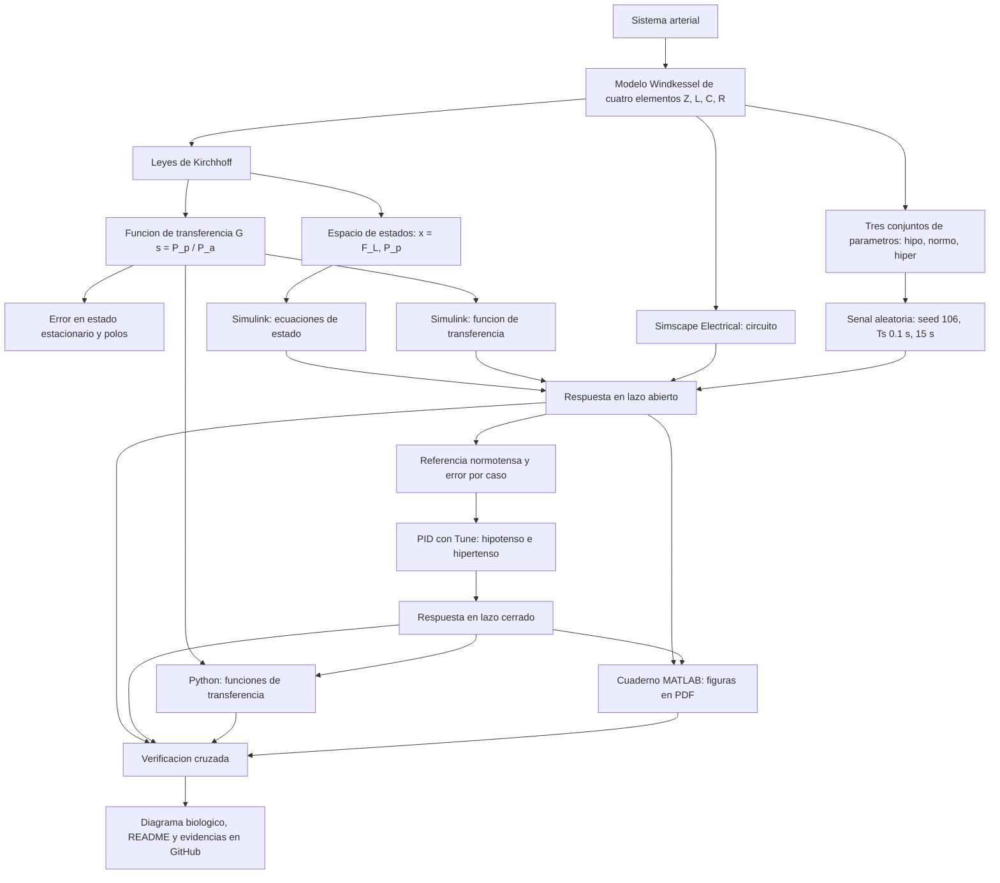

[](https://matlab.mathworks.com/open/github/v1?repo=KevinDarioITT/MSFP2)

# Práctica 2 — Modelado y control del sistema cardiovascular mediante el modelo Windkessel

Repositorio académico de la asignatura **Modelado de Sistemas Fisiológicos**, correspondiente al programa de **Ingeniería Biomédica** del Tecnológico Nacional de México / Instituto Tecnológico de Tijuana. La práctica integra modelado matemático, analogías eléctricas de sistemas fisiológicos, análisis de estabilidad, diseño de controladores PID, simulación computacional *in silico* y verificación cruzada entre plataformas.

El caso de estudio representa el **sistema arterial** mediante el **modelo Windkessel de cuatro elementos** ($Z$, $L$, $C$, $R$), un sistema lineal de segundo orden. Se comparan tres condiciones cardiovasculares —**normotenso** (control), **hipotenso** e **hipertenso** (casos)— y se diseñan dos controladores PID independientes que buscan reducir la diferencia entre la presión de cada caso y la respuesta del individuo normotenso.

**Docente:** Dr. Paul Antonio Valle Trujillo  
**Correo:** paul.valle@tectijuana.edu.mx  
**Departamento:** Ingeniería Eléctrica y Electrónica  
**Institución:** Tecnológico Nacional de México / Instituto Tecnológico de Tijuana  
**Asignatura:** Modelado de Sistemas Fisiológicos  
**Programa:** Ingeniería Biomédica  
**Estudiante:** Kevin Dario De La Cruz Bojorquez
**Numero de control:** 20210777 
**Correo:** l20210777@tijuana.tecnm.mx

**Repositorio de la asignatura:** https://github.com/DrPaulValle/MSF-IBF1020  
**Sede:** Blvd. Alberto Limón Padilla s/n, Tijuana, C. P. 22454, B. C., México.

## Contenido

1. [Resumen](#resumen)
2. [Competencia y objetivos](#objetivos)
3. [Relación con el temario](#temario)
4. [Modelo físico y analogía eléctrica](#analogia)
5. [Formulación matemática](#modelo)
6. [Análisis de error y estabilidad](#analisis)
7. [Señal de excitación y condiciones de simulación](#senales)
8. [Implementación en MATLAB, Simulink y Simscape](#matlab)
9. [Control en lazo cerrado y sintonización PID](#pid)
10. [Reproducción en Python](#python)
11. [Diagrama biológico](#biologico)
12. [Resultados y verificación cruzada](#resultados)
13. [Discusión y conclusiones](#discusion)
14. [Flujo de trabajo](#flujo)
15. [Actividades del estudiante](#actividades)
16. [Estructura del repositorio](#estructura)
17. [Requisitos](#requisitos)
18. [Reproducibilidad y entregables](#reproducibilidad)
19. [Referencias](#referencias)

---

<a id="resumen"></a>
## Resumen

La práctica tiene como propósito **modelar, analizar, simular y controlar** la dinámica de la presión arterial mediante el modelo Windkessel de cuatro elementos. El sistema arterial se representa con una impedancia característica $Z$ (región proximal), una inertancia $L$ (masa de la sangre en movimiento), una distensibilidad $C$ (capacidad de almacenar volumen) y una resistencia periférica $R$. Mediante la analogía **presión → voltaje** y **flujo sanguíneo → corriente**, el sistema se estudia como un circuito eléctrico. Aunque tiene cuatro elementos, solo $L$ y $C$ almacenan energía, por lo que el modelo es de **segundo orden**.

A partir de las leyes de Kirchhoff se obtiene la representación en espacio de estados con $\mathbf{x}=[F_L,\;P_p]^T$ y la función de transferencia $G(s)=P_p(s)/P_a(s)$ para tres conjuntos de parámetros que difieren **únicamente en la distensibilidad arterial $C$**: hipotenso ($3.5$), normotenso ($1.5$) e hipertenso ($1.0$ ml/mmHg). Se determinan el error en estado estacionario y los polos de cada modelo, y se simulan en lazo abierto con una señal aleatoria idéntica para los tres casos.

Posteriormente se construyen dos sistemas de retroalimentación independientes (normotenso–hipotenso y normotenso–hipertenso), cada uno con un **controlador PID** sintonizado con la herramienta *Tune* de Simulink. Los resultados se verifican de forma cruzada entre cinco implementaciones: ecuaciones de estado, función de transferencia y circuito en Simscape Electrical (Simulink), cuaderno de MATLAB y código en Python.

La práctica se desarrolla **exclusivamente mediante experimentación *in silico***. Las estrategias de control tienen propósitos **académicos y de simulación** y no constituyen una estrategia terapéutica ni una recomendación para el tratamiento de alteraciones de la presión arterial.

**Palabras clave:** modelo Windkessel; sistema cardiovascular; distensibilidad arterial; controlador PID; hipotensión; hipertensión; MATLAB; Simulink; Simscape Electrical; Python; simulación *in silico*.

[Volver al contenido](#contenido)

---

<a id="objetivos"></a>
## Competencia y objetivos

### Competencia a desarrollar

Modeliza sistemas fisiológicos mediante circuitos eléctricos equivalentes, ecuaciones diferenciales y funciones de transferencia para analizar su comportamiento dinámico, y diseña estrategias de control mediante técnicas de control clásico. En particular, el estudiante analiza el modelo Windkessel de cuatro elementos, compara la dinámica cardiovascular de un individuo normotenso (control) con dos casos simulados, hipotenso e hipertenso, y diseña estrategias de control *in silico* orientadas a reducir las diferencias entre las respuestas de los casos y la respuesta de referencia.

### Objetivo general

Modelar y controlar *in silico* la presión arterial mediante el modelo Windkessel de cuatro elementos, comparando la respuesta de un individuo normotenso con la de dos casos simulados (hipotenso e hipertenso) y verificando los resultados mediante diferentes plataformas computacionales.

### Objetivos específicos

- Identificar las variables $P_a(t)$, $P_p(t)$, $F_a(t)$, $F_L(t)$ y los parámetros $Z$, $C$, $R$, $L$, relacionando cada elemento con su propiedad hemodinámica.
- Aplicar las leyes de Kirchhoff para obtener el modelo en espacio de estados $\dot{\mathbf{x}}=A\mathbf{x}+Bu$.
- Obtener la función de transferencia $G(s)=P_p(s)/P_a(s)$ para los tres conjuntos de parámetros y relacionar su orden con los elementos de almacenamiento de energía.
- Determinar la respuesta final y el error en estado estacionario ante una entrada escalón.
- Calcular los polos, representarlos en el plano complejo y determinar la estabilidad de los tres modelos.
- Implementar los modelos mediante ecuaciones de estado, función de transferencia y circuito equivalente (Simscape Electrical) en Simulink.
- Simular los tres modelos en lazo abierto con la misma realización de una señal aleatoria.
- Construir dos sistemas de control con retroalimentación negativa y sintonizar un PID para cada caso.
- Analizar el efecto de cada controlador sobre el seguimiento de la referencia, el error y el transitorio.
- Reproducir los resultados en MATLAB (cuaderno) y Python, y verificarlos de forma cruzada.
- Elaborar un diagrama biológico que relacione el modelo con las estructuras fisiológicas.
- Documentar la práctica en un repositorio de GitHub.

[Volver al contenido](#contenido)

---

<a id="temario"></a>
## Relación con el temario

La práctica integra contenidos de la asignatura **Modelado de Sistemas Fisiológicos (IBF-1020)**:

| Unidad | Área | Contenidos aplicados |
|---|---|---|
| I | Sistemas de control retroalimentados | Diagramas de bloques, retroalimentación negativa, señal de error, respuesta temporal y criterios de estabilidad |
| II | Modelado matemático | Analogía circuito–sistema cardiovascular, leyes de Kirchhoff, espacio de estados y funciones de transferencia |
| III | Controladores | Controlador PID, sintonización de ganancias y análisis del desempeño en lazo cerrado |

El enfoque combina **Ingeniería de Control, Electrónica Analógica, Ciencias de la Computación y Fisiología**.

[Volver al contenido](#contenido)

---

<a id="analogia"></a>
## Modelo físico y analogía eléctrica

El modelo Windkessel tiene su origen en la propuesta de Otto Frank de representar el sistema arterial mediante una sección distensible y una resistencia periférica concentrada (**modelo de dos elementos**: $R$ y $C$). Posteriormente se incorporó una impedancia característica $Z$ asociada con la región proximal del lecho vascular y, finalmente, una inertancia $L$ que representa la masa de la sangre en movimiento, dando lugar al **modelo de cuatro elementos**.

La analogía utilizada es:

$$\text{presión}\;\rightarrow\;\text{voltaje},\qquad \text{flujo sanguíneo}\;\rightarrow\;\text{corriente}.$$

### Topología del circuito

$Z$ y $L$ están conectadas **en paralelo** entre los nodos $P_a$ y $P_p$; $C$ y $R$ están **en paralelo** entre el nodo $P_p$ y tierra.

```text
                 ┌──────── Z ────────┐   F_Z
                 │                   │
  P_a(t) ●───────┤                   ├───────●─────────────● P_p(t)
        F_a(t)   │                   │       │
                 └──────── L ────────┘   F_L │
                                             ├──────────┐
                                             │          │
                                           F_C ↓      F_R ↓
                                             │          │
                                            ═╧═ C       R
                                            ═╤═         │
                                             │          │
                                             └────┬─────┘
                                                 ═╧═  (tierra)
```

Esta es una representación esquemática; el diagrama original se encuentra en la Figura 5.1 del instructivo de la práctica.

### Variables y parámetros

| Símbolo | Equivalente eléctrico | Interpretación hemodinámica |
|---|---|---|
| $P_a(t)$ | Voltaje de entrada | Presión arterial de entrada |
| $P_p(t)$ | Voltaje en el nodo de $C$ y $R$ (salida) | Presión asociada con la distensibilidad arterial |
| $F_a(t)$ | Corriente de entrada | Flujo dirigido hacia la aorta o arteria pulmonar |
| $F_Z(t)$ | Corriente en $Z$ | Flujo a través de la impedancia característica |
| $F_L(t)$ | Corriente en $L$ | Flujo a través de la inertancia arterial |
| $F_C(t)$ | Corriente en $C$ | Flujo almacenado por distensión arterial |
| $F_R(t)$ | Corriente en $R$ | Flujo a través de la resistencia periférica |
| $Z$ | Resistencia | Impedancia característica de la región proximal del sistema arterial |
| $L$ | Inductancia | Inertancia arterial (efecto de la masa de sangre en movimiento) |
| $C$ | Capacitancia | Distensibilidad arterial total |
| $R$ | Resistencia | Resistencia periférica total |

### Conjuntos de parámetros

| Parámetro | Hipotenso | Normotenso (control) | Hipertenso | Unidades |
|---|---:|---:|---:|---|
| $Z$ | $0.010$ | $0.010$ | $0.010$ | $\mathrm{mmHg\cdot s\cdot ml^{-1}}$ |
| $L$ | $0.001$ | $0.001$ | $0.001$ | $\mathrm{mmHg\cdot s^{2}\cdot ml^{-1}}$ |
| $R$ | $1.000$ | $1.000$ | $1.000$ | $\mathrm{mmHg\cdot s\cdot ml^{-1}}$ |
| $C$ | $3.500$ | $1.500$ | $1.000$ | $\mathrm{ml\cdot (mmHg)^{-1}}$ |

Los tres conjuntos difieren **solo en la distensibilidad arterial $C$**; $Z$, $L$ y $R$ se mantienen constantes. En este modelo:

- Un **aumento de $C$** (caso hipotenso) representa un sistema arterial con mayor capacidad de distenderse y almacenar volumen, lo que tiende a atenuar los incrementos de presión producidos por la entrada cardiovascular.
- Una **disminución de $C$** (caso hipertenso) representa menor distensibilidad y mayor rigidez arterial, de modo que una variación de volumen puede producir cambios de presión más pronunciados.

[Volver al contenido](#contenido)

---

<a id="modelo"></a>
## Formulación matemática

### 1. Ecuaciones del circuito

Como $Z$ y $L$ están en paralelo entre $P_a$ y $P_p$, ambas tienen la misma diferencia de presión:

$$
P_a(t)-P_p(t)=L\frac{dF_L(t)}{dt},\qquad F_Z(t)=\frac{P_a(t)-P_p(t)}{Z}.
$$

Por conservación del flujo en el nodo de $P_p$:

$$
F_Z(t)+F_L(t)=F_C(t)+F_R(t),\qquad F_C(t)=C\frac{dP_p(t)}{dt},\qquad F_R(t)=\frac{P_p(t)}{R}.
$$

### 2. Representación en espacio de estados

Con las variables de estado $x_1(t)=F_L(t)$, $x_2(t)=P_p(t)$, la entrada $u(t)=P_a(t)$ y la salida $y(t)=P_p(t)$:

$$
\begin{aligned}
\dot F_L(t)&=-\frac{1}{L}P_p(t)+\frac{1}{L}P_a(t),\\[4pt]
\dot P_p(t)&=\frac{1}{C}F_L(t)-\left(\frac{1}{ZC}+\frac{1}{RC}\right)P_p(t)+\frac{1}{ZC}P_a(t).
\end{aligned}
$$

En forma matricial:

$$
\dot{\mathbf{x}}(t)=
\underbrace{\begin{bmatrix}
0 & -\dfrac{1}{L}\\[8pt]
\dfrac{1}{C} & -\left(\dfrac{1}{ZC}+\dfrac{1}{RC}\right)
\end{bmatrix}}_{A}\mathbf{x}(t)+
\underbrace{\begin{bmatrix}
\dfrac{1}{L}\\[8pt]
\dfrac{1}{ZC}
\end{bmatrix}}_{B}P_a(t),
\qquad
y(t)=\underbrace{\begin{bmatrix}0&1\end{bmatrix}}_{C_y}\mathbf{x}(t).
$$

### 3. Función de transferencia

Con condiciones iniciales nulas, la transformada de Laplace de las ecuaciones del circuito da:

$$
P_a(s)-P_p(s)=Ls\,F_L(s),\qquad
\frac{P_a(s)-P_p(s)}{Z}+F_L(s)=\left(Cs+\frac{1}{R}\right)P_p(s).
$$

Sustituyendo $F_L(s)$ y agrupando términos:

$$
(P_a-P_p)\,\frac{Ls+Z}{ZLs}=P_p\,\frac{RCs+1}{R}
\;\Longrightarrow\;
\boxed{G(s)=\frac{P_p(s)}{P_a(s)}=\frac{R\,(Ls+Z)}{ZLRC\,s^2+L(R+Z)\,s+RZ}}
$$

que, dividiendo entre $R$, equivale a

$$
G(s)=\frac{Ls+Z}{ZLC\,s^2+L\left(1+\dfrac{Z}{R}\right)s+Z}
=\frac{\dfrac{s}{ZC}+\dfrac{1}{LC}}{s^2+\left(\dfrac{1}{ZC}+\dfrac{1}{RC}\right)s+\dfrac{1}{LC}}.
$$

La misma expresión se obtiene con $G(s)=C_y(sI-A)^{-1}B$. El denominador es de **segundo grado** porque el modelo tiene **dos elementos independientes de almacenamiento de energía** ($L$ y $C$), aunque contiene cuatro elementos en total. Además, la función tiene **un cero** en

$$
s=-\frac{Z}{L}=-10\ \mathrm{s^{-1}}\quad(\text{igual en los tres casos}).
$$

### 4. Funciones de transferencia de los tres casos

Sustituyendo $Z=0.010$, $L=0.001$, $R=1.000$:

| Caso | $C$ | $G(s)$ (forma polinómica) | $G(s)$ (forma mónica) |
|---|---:|---|---|
| Hipotenso | $3.5$ | $\dfrac{0.001\,s+0.01}{3.5\times10^{-5}s^2+1.01\times10^{-3}s+0.01}$ | $\dfrac{28.571\,s+285.714}{s^2+28.857\,s+285.714}$ |
| Normotenso | $1.5$ | $\dfrac{0.001\,s+0.01}{1.5\times10^{-5}s^2+1.01\times10^{-3}s+0.01}$ | $\dfrac{66.667\,s+666.667}{s^2+67.333\,s+666.667}$ |
| Hipertenso | $1.0$ | $\dfrac{0.001\,s+0.01}{1.0\times10^{-5}s^2+1.01\times10^{-3}s+0.01}$ | $\dfrac{100\,s+1000}{s^2+101\,s+1000}$ |

[Volver al contenido](#contenido)

---

<a id="analisis"></a>
## Análisis de error y estabilidad

### 1. Respuesta final y error en estado estacionario

Para una entrada escalón unitario, $P_a(s)=1/s$, y si el sistema es estable puede aplicarse el teorema del valor final:

$$
\lim_{t\to\infty}P_p(t)=\lim_{s\to0}s\,G(s)\frac{1}{s}=G(0)=\frac{R\,Z}{R\,Z}=1.
$$

Por tanto, el error entre la entrada y la salida ante un escalón es

$$
\boxed{e_{ss}=\lim_{s\to0}s\,P_a(s)\,[1-G(s)]=1-G(0)=0}
$$

**para los tres casos**, ya que $G(0)=1$ no depende de $C$ (en régimen permanente la inertancia se comporta como un cortocircuito y $P_p=P_a$). Esto implica que **la condición hipotensa, normotensa o hipertensa no se distingue por su valor final ante un escalón**, sino por su **dinámica transitoria**, que depende de $C$ a través de los polos y del comportamiento en frecuencia.

Para frecuencias altas ($\omega\gg\omega_n$) se cumple $|G(j\omega)|\approx 1/(ZC\omega)$, de modo que un $C$ mayor atenúa más las variaciones rápidas de la entrada.

### 2. Polos y estabilidad

Los polos son las raíces de $ZLC\,s^2+L(1+Z/R)\,s+Z=0$. Con $\omega_n=1/\sqrt{LC}$ y $\zeta=\dfrac{1}{2\omega_n}\left(\dfrac{1}{ZC}+\dfrac{1}{RC}\right)$:

| Caso | $\omega_n$ (rad/s) | $\zeta$ | Polos | Tipo de respuesta |
|---|---:|---:|---|---|
| Hipotenso | $16.903$ | $0.854$ | $-14.429\pm j\,8.805$ | Subamortiguada (polos complejos conjugados) |
| Normotenso | $25.820$ | $1.304$ | $-12.062,\;-55.272$ | Sobreamortiguada (polos reales distintos) |
| Hipertenso | $31.623$ | $1.597$ | $-11.127,\;-89.873$ | Sobreamortiguada (polos reales distintos) |

Los tres modelos son **estables**, pues todos los polos tienen parte real negativa. Al disminuir $C$ el polo rápido se aleja del origen y la frecuencia natural aumenta; al aumentar $C$ ($3.5$) los polos se vuelven complejos conjugados y aparece comportamiento oscilatorio amortiguado.

### 3. Predicciones analíticas de la respuesta al escalón

Cálculo numérico de la respuesta al escalón unitario de cada $G(s)$ (útil como referencia previa para contrastar las simulaciones):

| Caso | Pendiente inicial $1/(ZC)$ (mmHg/s) | Tiempo al 90 % (ms) | Sobreimpulso | $t_s$ (2 %) (ms) |
|---|---:|---:|---:|---:|
| Hipotenso | $28.6$ | $\approx 51$ | $\approx 16.1\ \%$ | $\approx 304$ |
| Normotenso | $66.7$ | $\approx 27$ | $\approx 8.7\ \%$ | $\approx 214$ |
| Hipertenso | $100.0$ | $\approx 19$ | $\approx 6.2\ \%$ | $\approx 167$ |

El sobreimpulso aparece en los tres casos, incluso en los sobreamortiguados, por la presencia del cero en $s=-10\ \mathrm{s^{-1}}$. A mayor $C$, la respuesta es más lenta y con mayor sobreimpulso.

[Volver al contenido](#contenido)

---

<a id="senales"></a>
## Señal de excitación y condiciones de simulación

La entrada $P_a(t)$ se genera en Simulink con el bloque **Uniform Random Number**:

| Parámetro del bloque | Valor |
|---|---:|
| Mínimo | $0.2$ |
| Máximo | $1$ |
| Semilla (*seed*) | $106$ |
| Tiempo de muestreo $T_s$ | $0.1\ \mathrm{s}$ |
| Intervalo de simulación | $t\in[0,15]\ \mathrm{s}$ |

La señal es **constante por tramos** (cambia de valor cada $0.1\ \mathrm{s}$, unos 150 valores en 15 s). Se emplea **exactamente la misma realización** para los modelos hipotenso, normotenso e hipertenso, de manera que las diferencias entre sus respuestas sean consecuencia exclusiva de sus parámetros.

[Volver al contenido](#contenido)

---

<a id="matlab"></a>
## Implementación en MATLAB, Simulink y Simscape

Para cada una de las tres condiciones se construyen tres representaciones equivalentes:

| Implementación | Descripción | Aspecto por verificar |
|---|---|---|
| Ecuaciones de estado, Simulink | Bloques que implementan $\dot{\mathbf{x}}=A\mathbf{x}+Bu$, $y=C_y\mathbf{x}$ | Consistencia con las ecuaciones del circuito |
| Función de transferencia, Simulink | Bloque *Transfer Fcn* con $G(s)$ de cada caso | Respuesta entrada–salida de segundo orden |
| Circuito equivalente, Simscape Electrical | Componentes $Z$, $L$, $C$ y $R$ conectados según la Figura 5.1 | Concordancia con las representaciones matemáticas |

Las tres representaciones deben producir respuestas consistentes con los mismos parámetros, condiciones iniciales y señal de entrada.

### Ejecución desde el cuaderno MATLAB

El cuaderno computacional ejecuta los modelos de Simulink con la misma realización de la entrada aleatoria y almacena en el *Workspace* las respuestas del **modelo normotenso**, de los **dos casos en lazo abierto** y de los **dos casos en lazo cerrado**. Incluye una función que:

1. representa gráficamente las respuestas;
2. identifica correctamente las variables y sus unidades;
3. compara referencia, caso y sistema controlado; y
4. guarda las figuras en formato PDF.

[Volver al contenido](#contenido)

---

<a id="pid"></a>
## Control en lazo cerrado y sintonización PID

### 1. Esquema de control

La respuesta del individuo **normotenso** se utiliza como **referencia**. Se construyen **dos sistemas independientes** (normotenso–hipotenso y normotenso–hipertenso) siguiendo el esquema de la Figura 5.2 del instructivo: la misma señal $V_e(t)$ excita al modelo normotenso (control) y al caso; la señal de error entre la referencia y la salida del caso es procesada por un PID cuya salida actúa sobre la planta del caso (paciente/tratamiento), con retroalimentación negativa. Las señales de error son

$$
e_{\text{hipo}}(t)=P_{p,\text{normo}}(t)-P_{p,\text{hipo}}(t),\qquad
e_{\text{hiper}}(t)=P_{p,\text{normo}}(t)-P_{p,\text{hiper}}(t).
$$

La ley de control ideal y su forma en Laplace son

$$
u(t)=k_Pe(t)+k_I\int_0^t e(\tau)\,d\tau+k_D\frac{de(t)}{dt},
\qquad
K(s)=k_P+\frac{k_I}{s}+k_Ds.
$$

Para cada caso, con $G_{\text{caso}}(s)$ como planta y $P_{p,\text{normo}}$ como referencia, la función de transferencia de lazo cerrado es

$$
T(s)=\frac{K(s)\,G_{\text{caso}}(s)}{1+K(s)\,G_{\text{caso}}(s)},
\qquad
P_{p,\text{caso,PID}}(s)=T(s)\,P_{p,\text{normo}}(s).
$$

### 2. Sintonización

Los controladores se sintonizan **de forma independiente** con la herramienta **Tune** del bloque *PID Controller* de Simulink, buscando una respuesta **estable** y una **reducción del error** entre cada caso y la respuesta normotensa. Debe conservarse evidencia de la configuración utilizada durante la sintonización.

Como la sintonización depende de la versión del software y del criterio elegido, no es necesario reproducir exactamente valores de referencia: lo importante es justificar el criterio y demostrar que los controladores son estables y reducen el error.

[Volver al contenido](#contenido)

---

<a id="python"></a>
## Reproducción en Python

Como verificación independiente, se implementan en Python (Visual Studio Code) las funciones de transferencia $G_{\text{hipo}}(s)$, $G_{\text{normo}}(s)$ y $G_{\text{hiper}}(s)$. El código:

1. reproduce la **misma señal de entrada** usada en MATLAB/Simulink;
2. obtiene las respuestas en lazo abierto de los tres modelos;
3. incorpora las ganancias PID obtenidas con *Tune*;
4. construye los sistemas en lazo cerrado de los casos hipotenso e hipertenso; y
5. genera y guarda las figuras para compararlas con MATLAB/Simulink.

[Volver al contenido](#contenido)

---

<a id="biologico"></a>
## Diagrama biológico

Se elabora con BioRender (o herramienta equivalente) un diagrama del sistema cardiovascular que relaciona los elementos del modelo con las estructuras fisiológicas. Debe identificar como mínimo: corazón, aorta, grandes arterias, vasos periféricos, flujo sanguíneo, presión arterial, distensibilidad arterial y resistencia periférica.

| Elemento del modelo | Propiedad hemodinámica | Estructura / concepto fisiológico asociado |
|---|---|---|
| $P_a(t)$, $F_a(t)$ | Presión y flujo de entrada | Salida del corazón hacia la aorta (o arteria pulmonar) |
| $Z$ | Impedancia característica | Región proximal del sistema arterial (aorta proximal) |
| $L$ | Inertancia arterial | Masa de la sangre en movimiento (aceleración y desaceleración) |
| $C$ | Distensibilidad arterial total | Capacidad de aorta y grandes arterias de distenderse y almacenar volumen |
| $R$ | Resistencia periférica total | Oposición al flujo en los vasos periféricos |
| $P_p(t)$ | Presión asociada con la distensibilidad | Presión arterial sobre la compliancia arterial |

[Volver al contenido](#contenido)

---

<a id="resultados"></a>
## Resultados y verificación cruzada

### 1. Respuesta en lazo abierto

Se aplica la misma señal aleatoria a los tres modelos y se registra $P_p(t)$, comparando $P_{p,\text{hipo}}(t)$, $P_{p,\text{normo}}(t)$ y $P_{p,\text{hiper}}(t)$.

**Expectativa según el análisis previo** (para contrastar con tus resultados): como $G(0)=1$ en los tres modelos, la presión media debería ser similar y las diferencias deberían aparecer en la dinámica: el caso hipotenso ($C$ mayor) debería suavizar más los cambios bruscos de la entrada y responder más lento, mientras que el hipertenso ($C$ menor) debería seguirlos más rápido y de forma más pronunciada.

### 2. Respuesta en lazo cerrado

Se comparan, para el caso hipotenso, $P_{p,\text{normo}}(t)$, $P_{p,\text{hipo}}(t)$ y $P_{p,\text{hipo,PID}}(t)$, y para el caso hipertenso, $P_{p,\text{normo}}(t)$, $P_{p,\text{hiper}}(t)$ y $P_{p,\text{hiper,PID}}(t)$.

<a id="discusion"></a>
## Discusión y conclusiones

### Discusión

**Efecto de $C$ en la dinámica.** El análisis muestra que variar solo la distensibilidad arterial modifica la ubicación de los polos, la frecuencia natural y el amortiguamiento (de $\zeta=0.854$ en el caso hipotenso a $\zeta=1.597$ en el hipertenso). Como $G(0)=1$ en los tres modelos, el valor final ante un escalón es el mismo; la diferencia está en la rapidez y la forma del transitorio y en la atenuación de las variaciones rápidas de la entrada.

**Lazo abierto.** Compara las tres respuestas obtenidas y relaciónalas con los polos y las predicciones analíticas de la tabla de escalón.

**Lazo cerrado.**  Analiza el efecto de cada PID sobre el seguimiento de la referencia, el error y el comportamiento transitorio; indica si fue necesario ajustar el criterio de sintonización y qué diferencias hubo entre el controlador del caso hipotenso y el del hipertenso.

**Limitaciones.** El modelo es lineal, de parámetros concentrados y de segundo orden; los casos hipotenso e hipertenso se generan modificando solo $C$, lo cual es una simplificación de condiciones fisiológicas reales. La entrada aleatoria constante por tramos no representa una onda de presión cardiaca real. Los resultados corresponden únicamente a simulación.

### Conclusiones

- El modelo Windkessel de cuatro elementos es un sistema de **segundo orden** con un cero en $s=-Z/L$ y polos que dependen de $C$; los tres modelos resultan **estables**.
- Con $G(0)=1$, el **error en estado estacionario ante un escalón es cero** en los tres casos; las diferencias entre condiciones son **transitorias**.
- Las estrategias de control desarrolladas tienen **fines académicos y de simulación** y **no** constituyen una recomendación terapéutica.

[Volver al contenido](#contenido)

---

<a id="flujo"></a>
## Flujo de trabajo



[Volver al contenido](#contenido)

---

<a id="actividades"></a>
## Actividades del estudiante

La práctica sigue la secuencia de 16 actividades del instructivo (marca las que hayas completado).

### Etapa 1. Modelo y análisis

- [ ] 1. Identificar las variables $P_a$, $P_p$, $F_a$, $F_L$ y los parámetros $Z$, $C$, $R$, $L$ con su significado hemodinámico.
- [ ] 2. Formular el modelo dinámico $\dot{\mathbf{x}}=A\mathbf{x}+Bu$ con $\mathbf{x}=[F_L,\;P_p]^T$.
- [ ] 3. Obtener $G_{\text{hipo}}(s)$, $G_{\text{normo}}(s)$ y $G_{\text{hiper}}(s)$ y relacionar su orden con los elementos de almacenamiento.
- [ ] 4. Calcular la respuesta final y el error en estado estacionario ante un escalón.
- [ ] 5. Calcular los polos, ubicarlos en el plano complejo y determinar la estabilidad.

### Etapa 2. Simulación en lazo abierto

- [ ] 6. Implementar ecuaciones de estado, función de transferencia y circuito Simscape para las tres condiciones.
- [ ] 7. Generar la señal de excitación (`Uniform Random Number`: mín. 0.2, máx. 1, seed 106, $T_s=0.1$ s, 15 s).
- [ ] 8. Analizar la respuesta en lazo abierto de los tres modelos.

### Etapa 3. Control

- [ ] 9. Construir los sistemas de control normotenso–hipotenso y normotenso–hipertenso con bloque PID.
- [ ] 10. Sintonizar cada PID con *Tune* y registrar las ganancias y la evidencia.
- [ ] 11. Analizar las respuestas en lazo cerrado.

### Etapa 4. Reproducción, verificación y documentación

- [ ] 12. Desarrollar el cuaderno de MATLAB y la función de graficación (figuras en PDF).
- [ ] 13. Implementar el código en Python y comparar con MATLAB/Simulink.
- [ ] 14. Realizar la verificación cruzada de las cinco implementaciones.
- [ ] 15. Elaborar el diagrama biológico.
- [ ] 16. Documentar en GitHub: este `README.md` y un `CITATION.cff` con los datos del alumno y del repositorio.

[Volver al contenido](#contenido)

---

<a id="estructura"></a>
## Requisitos

- **MATLAB** y **Simulink**.
- **Simscape Electrical**, para el circuito equivalente.
- Herramientas de Simulink para sintonización del bloque **PID Controller** (*Tune*).
- **Control System Toolbox**, para las funciones `tf`, `pole`, `dcgain` y `pzmap` usadas en las verificaciones.
- **Python** y **Visual Studio Code**, con las bibliotecas que importe tu código.
- **Git y GitHub**, para organizar y presentar el repositorio.
- **BioRender** o herramienta equivalente, para el diagrama biológico.

[Volver al contenido](#contenido)

---

<a id="reproducibilidad"></a>
## Reproducibilidad y entregables

### Secuencia de reproducción

1. Descargar el repositorio y abrir el cuaderno de MATLAB (o usar el botón *Open in MATLAB Online*).
2. Verificar los parámetros de los tres casos y la configuración del bloque `Uniform Random Number` (mín. 0.2, máx. 1, seed 106, $T_s=0.1$ s) y el intervalo $[0,15]$ s.
3. Ejecutar los modelos de Simulink (estado, función de transferencia y Simscape) y verificar su consistencia.
4. Ejecutar el cuaderno para obtener las respuestas en lazo abierto y lazo cerrado y exportar las figuras en PDF.
5. Ejecutar el código de Python con la misma señal de entrada y las ganancias PID registradas.
6. Comparar los resultados entre plataformas.

### Entregables solicitados en el repositorio

| Entregable | Evidencia |
|---|---|
| Modelo matemático | Desarrollo del modelo Windkessel, ecuaciones de estado y funciones de transferencia (este README) |
| Parámetros | Tabla de los modelos hipotenso, normotenso e hipertenso |
| MATLAB y Simulink | Archivos de MATLAB/Simulink y modelo de Simscape Electrical |
| Python | Código fuente |
| Señal de entrada | Archivo o descripción de la señal utilizada |
| Figuras | Figuras generadas con MATLAB y Python |
| Resultados | Sistemas en lazo abierto y en lazo cerrado |
| Control | Ganancias obtenidas para los dos controladores |
| Diagrama biológico | Imagen del diagrama |
| Capturas | Capturas de las simulaciones |
| Documentación | `README.md` (reporte) y `CITATION.cff` |

### Criterios de presentación académica

Este README funciona como **reporte** de la práctica: describe el modelo, el desarrollo matemático, las diferencias entre los tres conjuntos de parámetros, los resultados en lazo abierto, el diseño de los controladores, las respuestas en lazo cerrado, la verificación entre plataformas, la discusión y las conclusiones. Debe distinguirse entre los resultados obtenidos por el alumno y cualquier material de referencia proporcionado por la asignatura.

[Volver al contenido](#contenido)

---

<a id="referencias"></a>
## Referencias

[1] M. C. Khoo, *Physiological Control Systems: Analysis, Simulation, and Estimation*, 2nd ed., IEEE Press, 2018.

[2] F. C. Hoppensteadt y C. S. Peskin, *Modeling and Simulation in Medicine and the Life Sciences*, Springer.

[3] J. E. Hall, *Guyton and Hall Textbook of Medical Physiology*, 14th ed., Elsevier, 2021.

[4] K. Ogata, *Ingeniería de Control Moderna*, 5.ª ed., Pearson Educación, 2010.

[5] N. S. Nise, *Control Systems Engineering*, 8th ed., John Wiley & Sons, 2020.

[6] P. A. Valle, *Syllabus para Modelado de Sistemas Fisiológicos*, Tecnológico Nacional de México / Instituto Tecnológico de Tijuana, Tijuana, B. C., México, 2026. Disponible en: https://biomath.xyz/course/

[7] Tecnológico Nacional de México, *Programa de estudio de la asignatura Modelado de Sistemas Fisiológicos, IBF-1020*.

---

## Uso académico

Este repositorio se utiliza como evidencia de la práctica **Modelado y control del sistema cardiovascular mediante el modelo Windkessel** de la asignatura **Modelado de Sistemas Fisiológicos**. La práctica se desarrolla exclusivamente mediante experimentación *in silico*. Las estrategias de control desarrolladas tienen propósitos exclusivamente académicos y de simulación y no constituyen una estrategia terapéutica ni una recomendación para el tratamiento de alteraciones de la presión arterial.
